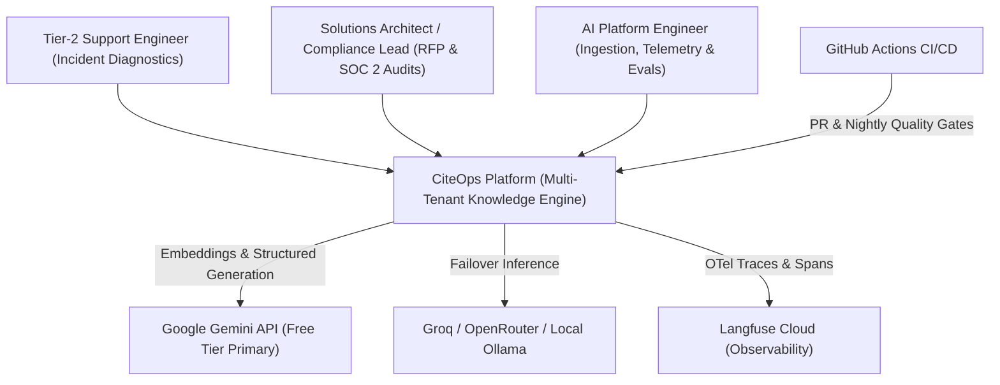
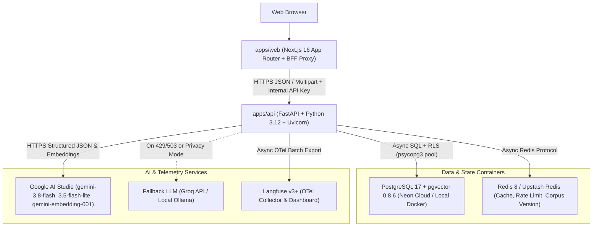
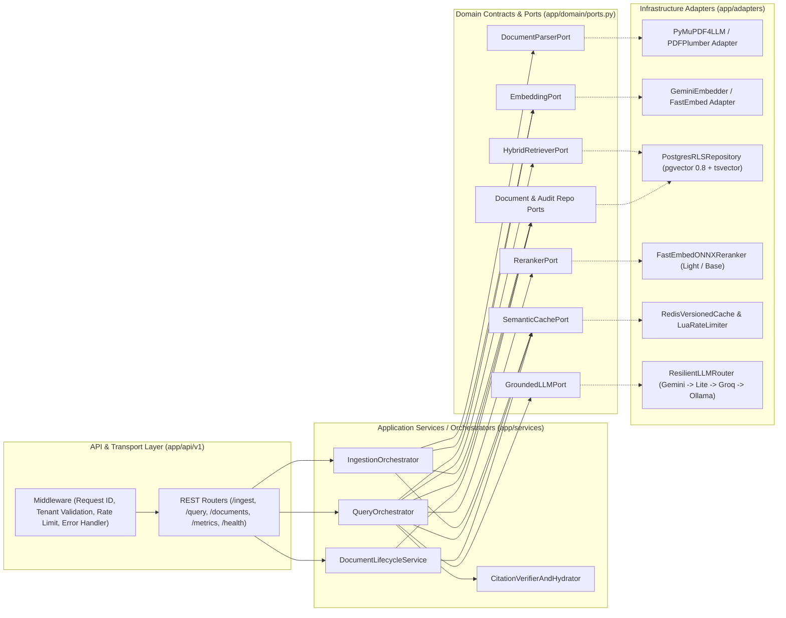
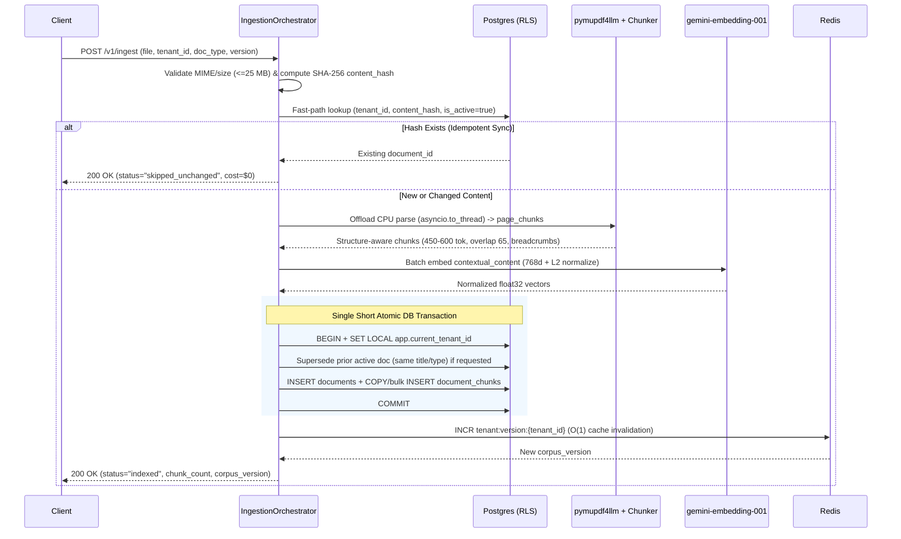
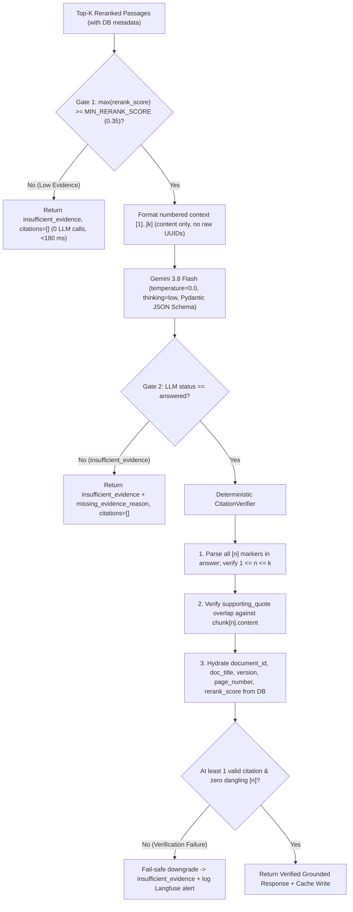
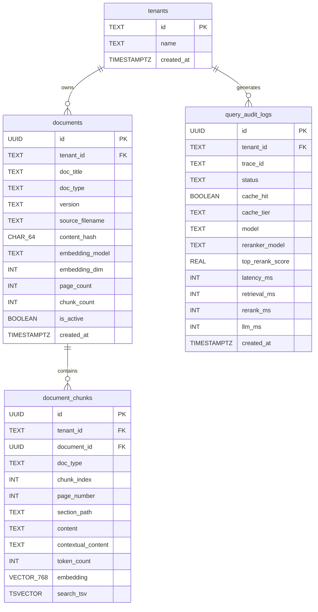
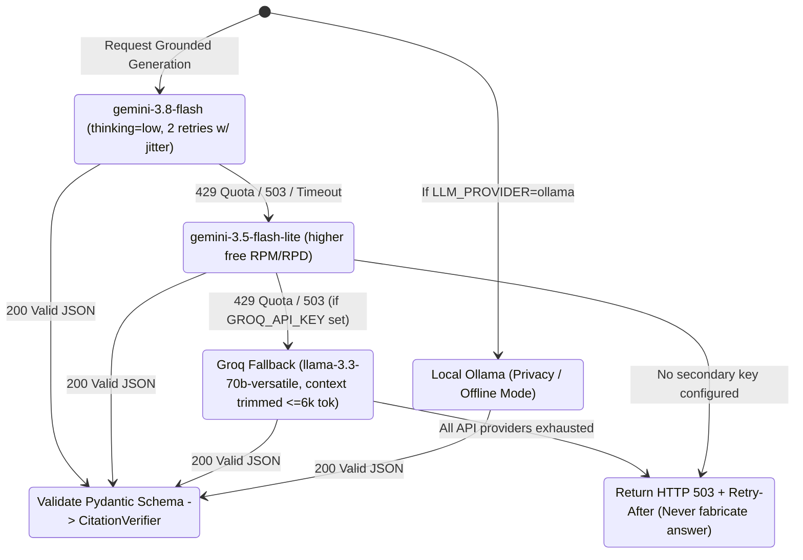
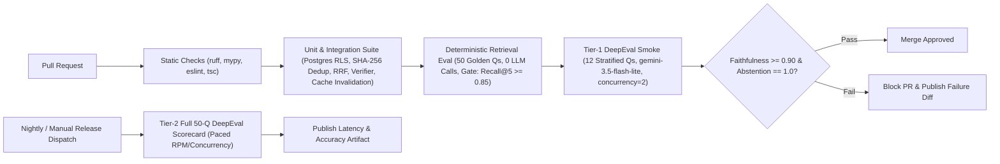

# System Architecture Specification: CiteOps

**System:** CiteOps — Multi-Tenant Tier-2 Support & Security Compliance Knowledge Engine  
**Architecture Style:** Modular Monolith (Hexagonal / Ports & Adapters) + BFF Web Client  
**Related Specifications:** [Problem.md](./Problem.md) | [PRD.md](./PRD.md)  
**Last Updated:** 2026-11-21  

---

## 1. Architectural Vision & Guiding Principles

CiteOps is engineered as a **deterministic knowledge and compliance engine**, not a thin LLM wrapper. Every layer enforces explicit correctness, isolation, latency, and cost invariants so the system operates reliably on **`$0/month` free-tier infrastructure** while remaining ready to scale into enterprise production without rewrites.

### Core Engineering Principles
1. **Defense-in-Depth Multi-Tenancy (Fail-Closed Security):** Tenant isolation is enforced at four independent layers—BFF/API validation, PostgreSQL Row-Level Security (RLS) under a non-`BYPASSRLS` role, tenant-namespaced Redis keys, and tagged telemetry. If any context is missing, access fails closed.
2. **Hexagonal Architecture (Ports & Adapters):** Core RAG workflows (ingestion, retrieval, reranking, caching, citation verification) depend solely on typed Python `Protocol` interfaces, decoupling business logic from specific vendors (Gemini, Groq, Ollama, FastEmbed, Neon, Upstash, Langfuse).
3. **Deterministic Grounding Over "Prompt Hope":** LLMs synthesize answers and cite local passage indices `[1..k]`, while deterministic server-side code enforces abstention gates, validates citation bounds, verifies excerpts, and hydrates authoritative document metadata directly from PostgreSQL.
4. **ACID Single-Store Simplicity:** Storing document metadata, `pgvector` HNSW embeddings, and dual-dictionary `tsvector` indices in PostgreSQL 17 eliminates cross-database consistency bugs and dual-write drift.
5. **Fail-Open Caching, Fail-Closed Isolation:** If Redis is temporarily unreachable, the system degrades gracefully to direct PostgreSQL retrieval rather than failing queries, while tenant RLS in PostgreSQL always remains strictly enforced.
6. **Memory- and Quota-Aware Free-Tier Engineering:** All default runtime profiles (768-dim API embeddings, ~80 MB ONNX reranker, bounded thread pools, two-tier CI evals, LLM failover chain) are engineered to stay under **400 MB RSS** on 512 MB free cloud instances and survive upstream `429` rate limits.

---

## 2. C4 Architecture Views

### 2.1 Level 1 — System Context Diagram



### 2.2 Level 2 — Container Diagram



### 2.3 Level 3 — Backend Component Architecture (`apps/api`, Hexagonal Pattern)

Inside `apps/api`, dependencies point strictly **inward** toward domain models and ports. Infrastructure SDKs (`google-genai`, `litellm`, `fastembed`, `psycopg`, `redis`, `pymupdf4llm`, `langfuse`) are isolated inside adapters.



---

## 3. Core Pipeline Deep Dives

### 3.1 Idempotent Document Ingestion Pipeline

A critical production pattern in `IngestionOrchestrator` is **keeping external I/O (PDF parsing & embedding API calls) strictly outside PostgreSQL transactions**. Holding a database transaction open during network calls exhausts connection pools and risks long-lived table locks.



#### Structure-Aware Chunking Rules
* **PDF Extraction:** `pymupdf4llm.to_markdown(stream, page_chunks=True)` preserves 1-based page numbers, Markdown headings, and tabular layouts (critical for Enterprise SLA tables and SOC 2 control matrices).
* **Boundary Preservation:** Split hierarchically on Markdown `H1 -> H2 -> H3` sections; never split inside fenced code blocks (` ``` `) or Markdown tables unless a single block exceeds the hard ceiling (`600` tokens).
* **Contextual Enrichment:** Each chunk persists two text fields:
  * `content`: exact raw source excerpt displayed in the Source Inspector Drawer.
  * `contextual_content`: `[Document: {doc_title} | Version: {version} | Section: {section_path} | Page: {page_number}]\n{content}` — used for embedding generation and `tsvector` indexing so section identifiers (`Section 4.2`) and version strings (`v2.4.1`) stay attached to every passage.

---

### 3.2 Hybrid Retrieval, RRF & Calibrated Reranking Engine

#### Single-Query Hybrid RRF Pattern in PostgreSQL 17
Rather than issuing two separate network round-trips to Postgres and merging in Python, CiteOps executes both branches and Reciprocal Rank Fusion inside a **single parameterized SQL CTE** within the tenant-scoped RLS transaction:

```sql
-- Executed inside transaction with:
--   SET LOCAL app.current_tenant_id = $1;
--   SET LOCAL hnsw.iterative_scan = relaxed_order;
--   SET LOCAL hnsw.ef_search = 64;
--   SET LOCAL hnsw.max_scan_tuples = 20000;

WITH dense_candidates AS (
    SELECT
        c.id,
        ROW_NUMBER() OVER (ORDER BY c.embedding <=> $2::vector) AS dense_rank
    FROM document_chunks c
    JOIN documents d ON d.id = c.document_id
    WHERE c.tenant_id = $1
      AND d.is_active = true
      AND ($3::text[] IS NULL OR c.doc_type = ANY($3::text[]))
    ORDER BY c.embedding <=> $2::vector
    LIMIT 50
),
lexical_query AS (
    SELECT (
        websearch_to_tsquery('simple', $4) ||
        websearch_to_tsquery('english', $4)
    ) AS q
),
lexical_candidates AS (
    SELECT
        c.id,
        ROW_NUMBER() OVER (
            ORDER BY ts_rank_cd(c.search_tsv, lq.q, 32) DESC
        ) AS lexical_rank
    FROM document_chunks c
    JOIN documents d ON d.id = c.document_id
    CROSS JOIN lexical_query lq
    WHERE c.tenant_id = $1
      AND d.is_active = true
      AND ($3::text[] IS NULL OR c.doc_type = ANY($3::text[]))
      AND c.search_tsv @@ lq.q
    ORDER BY ts_rank_cd(c.search_tsv, lq.q, 32) DESC
    LIMIT 50
),
rrf_fused AS (
    SELECT
        COALESCE(dc.id, lc.id) AS chunk_id,
        COALESCE(1.0 / (60 + dc.dense_rank), 0.0) +
        COALESCE(1.0 / (60 + lc.lexical_rank), 0.0) AS rrf_score
    FROM dense_candidates dc
    FULL OUTER JOIN lexical_candidates lc ON dc.id = lc.id
)
SELECT
    c.id, c.document_id, d.doc_title, c.doc_type, d.version,
    c.page_number, c.section_path, c.content, c.contextual_content,
    r.rrf_score
FROM rrf_fused r
JOIN document_chunks c ON c.id = r.chunk_id
JOIN documents d ON d.id = c.document_id
ORDER BY r.rrf_score DESC
LIMIT $5;  -- RERANK_CANDIDATE_COUNT (default 25, max 50)
```

#### Why This SQL Pattern Matters in Production
1. **`hnsw.iterative_scan = relaxed_order` (`pgvector >= 0.8.0`):** Solves the classic HNSW filtered-search recall collapse where small tenants yield `< 50` (or `0`) candidates because global HNSW neighbors belong to larger tenants.
2. **Dual-Dictionary `tsvector`:** Combining `'simple'` (weight `A`, no stemming, preserves tokens like `ERR_SIG_4092`, `v2.4.1`, `AES-256`) with `'english'` (weight `B`, stemmed natural language) eliminates dense blind spots while remaining 100% compatible with managed Neon Postgres.
3. **Sigmoid Reranker Calibration:** Cross-encoders (`Xenova/ms-marco-MiniLM-L-6-v2` and `BAAI/bge-reranker-base`) emit unbounded logits (e.g., `-6.2` to `+8.4`). `FastEmbedONNXReranker` runs inference inside a bounded worker pool (`asyncio.to_thread` guarded by an `asyncio.Semaphore(2)`) and normalizes raw logits via:
   $$\text{rerank\_score} = \frac{1}{1 + e^{-\text{logit}}}$$
   This guarantees a stable `(0, 1)` confidence scale for Gate-1 abstention thresholds and UI telemetry badges.

---

### 3.3 Grounded Generation, Dual-Gate Abstention & Citation Verification

Standard RAG systems ask the LLM to output `document_id`, `doc_title`, and `page_number` inside JSON — causing frequent metadata hallucinations. CiteOps separates **LLM reasoning** from **authoritative metadata hydration**.



#### Strict LLM Output Contract (`LLMGenerationSchema`)
```python
class UsedPassage(BaseModel):
    passage_index: int = Field(ge=1, description="1-based index of the cited context passage.")
    supporting_quote: str = Field(description="Short verbatim quote copied from the cited passage.")

class GroundedLLMOutput(BaseModel):
    status: Literal["answered", "insufficient_evidence"]
    answer: str = Field(description="Grounded answer citing inline markers like [1][2], or brief gap notice.")
    missing_evidence_reason: str | None = None
    used_passages: list[UsedPassage] = Field(default_factory=list)
```
Because `document_id`, `doc_title`, `doc_type`, `version`, `page_number`, `section_path`, and `rerank_score` are injected solely by `CitationVerifierAndHydrator` from PostgreSQL rows, **metadata fabrication is structurally impossible**.

---

### 3.4 Generation-Versioned Two-Tier Semantic Cache & Rate Limiter

#### Key Namespace & $O(1)$ Invalidation Strategy
Deleting cached keys via `SCAN`/`KEYS` on every document upload does not scale and blocks Redis. CiteOps uses **Generation-Based Key Versioning**:

* **Version Key:** `tenant:version:{tenant_id}` (integer, initialized to `1`, incremented via atomic `INCR` whenever `/v1/ingest` indexes a new document or `/v1/documents/{id}` deletes a document).
* **Filter Fingerprint:** `doc_types_key = sha1(",".join(sorted(doc_types)))[:12]` (or `"all"` when unfiltered).
* **L1 Exact Normalized Cache (TTL `24h`):**
  * Key: `cache:exact:{tenant_id}:v{corpus_version}:{doc_types_key}:{sha256(normalize(query))}`
  * Lookup time: `~1–15 ms` (zero embedding API call, zero DB query, zero LLM call).
* **L2 Tenant-Bounded Semantic Cache (TTL `24h`, Cosine `> 0.95`):**
  * Key: `cache:vec:{tenant_id}:v{corpus_version}:{doc_types_key}` (Redis Hash or List capped at `500` most recent entries via LRU eviction).
  * Each entry stores packed `float32` normalized query embedding (`768 × 4 = 3,072 bytes`) + compressed JSON response.
  * Lookup fetches the tenant scope's packed matrix (`<= 1.5 MB` worst case; typically `< 150 KB` for 50 hot RFP questions) and executes a single NumPy BLAS matrix-vector dot product (`embeddings @ query_vec`, `< 0.5 ms` on CPU).
  * **Portability:** Works identically on **Upstash Redis Free** (which lacks RediSearch) and local **Redis 8**. An optional `Redis8VectorCacheAdapter` implementing the same `SemanticCachePort` can swap in RediSearch `FT.SEARCH` for deployments exceeding `5,000` hot cached queries per tenant.

#### Atomic Sliding-Window Rate Limiter (Redis Lua)
To protect free-tier upstream quotas against bursts, admission control runs a single atomic Redis Lua script (`ZREMRANGEBYSCORE` + `ZCARD` + `ZADD` + `PEXPIRE`):
1. **Per-Tenant API Limit:** `20 req/min` on `rl:tenant:{tenant_id}` (prevents noisy-neighbor abuse).
2. **Global LLM Miss Budget:** `12 req/min` on `rl:llm:global` (checked **only on cache misses before calling the LLM**, so cache hits stay fast and unrestricted even when upstream LLM RPM is near saturation).

---

## 4. Data Architecture & Multi-Tenant Security Model

### 4.1 Entity-Relationship Diagram



> **Note on `query_audit_logs`:** Stores operational telemetry (no raw sensitive prompt/document PII unless explicitly enabled) under PostgreSQL RLS. Powers `GET /v1/metrics/summary` with exact p50/p95 `PERCENTILE_CONT` SQL queries without coupling the web UI to Langfuse's rate-limited read API.

### 4.2 Multi-Tenant Security Controls (Defense-in-Depth Matrix)

| Layer | Security Control | Failure Behavior |
| :--- | :--- | :--- |
| **1. Edge / BFF (`apps/web`)** | Server-side Next.js Route Handlers inject `X-Internal-API-Key` and forward validated requests; backend keys never enter browser JS. | Missing/invalid internal key -> `401 Unauthorized` |
| **2. API Schema (`FastAPI`)** | Strict regex `^[a-z0-9][a-z0-9_-]{1,62}$` on `tenant_id`; reject missing or malformed headers/body fields before DB access. | Invalid `tenant_id` -> `422 Unprocessable Entity` |
| **3. Database Role (`PostgreSQL`)** | Runtime pool connects as `citeops_app` (`NOSUPERUSER NOBYPASSRLS`). Migrations run under separate `citeops_migrator` role. | Prevents accidental RLS bypass |
| **4. Row-Level Security (`RLS`)** | `ENABLE ROW LEVEL SECURITY` + `FORCE ROW LEVEL SECURITY` on `documents`, `document_chunks`, and `query_audit_logs` matching `current_setting('app.current_tenant_id', true)`. | Unset session variable -> `0 rows` visible (fail-closed) |
| **5. Cache (`Redis`)** | All exact/semantic keys include `{tenant_id}:v{corpus_version}:{doc_types_key}`. No cross-tenant shared vector pool. | Impossible to return another tenant's cached answer |
| **6. Embedding Integrity** | `documents` records `embedding_model` and `embedding_dim`. Startup health check asserts active runtime embedding config matches indexed metadata to prevent silent vector-space mismatch. | Startup warning / fail-fast mismatch guard |

---

## 5. Frontend Architecture (`apps/web`)

Built on **Next.js 16 (App Router) + React 19 + TypeScript + Tailwind CSS v4 + `shadcn/ui` + TanStack Query v5**.

### Key Architectural Patterns
1. **Backend-for-Frontend (BFF) Proxy (`src/app/api/citeops/[...path]/route.ts`):**
   * Browser components call same-origin `/api/citeops/v1/...`.
   * The Next.js server handler attaches server-only `CITEOPS_API_URL` and `CITEOPS_INTERNAL_API_KEY`, eliminating browser CORS complexity and secret exposure.
2. **Server vs. Client Component Split:**
   * Layout shells, navigation, and static metadata use React Server Components.
   * Interactive surfaces (`CitationWorkspace`, `SourceInspectorDrawer`, `DocumentUploadModal`, `MetricsCharts`) are isolated Client Components hydrated with TanStack Query.
3. **Deterministic State & Cache Sync (`TanStack Query v5`):**
   * Query keys are strictly tenant-scoped: `["documents", tenantId, docType]`, `["metrics", tenantId]`.
   * Successful upload (`POST /v1/ingest`) or delete (`DELETE /v1/documents/{id}`) triggers `queryClient.invalidateQueries({ queryKey: ["documents", tenantId] })` and displays an immediate deduplication toast (`Indexed 42 chunks` vs. `Skipped unchanged — $0 embedding cost`).
4. **Interactive Citation Binding:**
   * Answer prose is tokenized safely (no `dangerouslySetInnerHTML`) by matching `[n]` markers against `response.citations`, rendering accessible `<CitationBadge index={n} />` buttons.
   * Clicking any `[n]` badge opens/focuses the `SourceInspectorDrawer` scrolled to citation `n` with highlighted `excerpt`, `doc_title`, `version`, `page_number`, `section_path`, and calibrated `rerank_score`.

---

## 6. Resilience, Concurrency & Free-Tier Resource Engineering

### 6.1 Concurrency & Event-Loop Isolation (`apps/api`)
FastAPI runs asynchronously on `uvicorn`, while `pymupdf4llm` and `FastEmbed` ONNX inference are **CPU-bound**. Running them directly inside `async def` routes blocks the event loop and spikes latency for concurrent health checks and cache hits.

* **Async I/O Pool:** `psycopg_pool.AsyncConnectionPool` (min `2`, max `10` connections, Neon-compatible `prepare_threshold=0` / pooler-safe settings) + `redis.asyncio`.
* **CPU Worker Isolation:** PDF parsing and ONNX cross-encoder inference execute via `await asyncio.to_thread(...)` bounded by an `asyncio.Semaphore(2)` to cap peak working RAM and prevent CPU thrashing on 1-vCPU free instances.
* **Single Worker Memory Discipline:** On 512 MB cloud containers (Render Free), run `uvicorn --workers 1` so the ONNX reranker weights (`~80 MB` for `ms-marco-MiniLM-L-6-v2`) are loaded once in memory rather than duplicated across forked processes.

### 6.2 Resilient LLM Failover Router



> **Groq TPM Guard:** Because Groq's free tier enforces strict `8,000–12,000 TPM` limits, the failover adapter trims passage context cleanly to `top_k <= 3` (`~3,000` input tokens) when routing to Groq so fallback calls do not immediately `429`.

### 6.3 Failure Mode & Graceful Degradation Matrix

| Dependency Failure | System Behavior | User Impact |
| :--- | :--- | :--- |
| **Redis Unavailable / Timeout (`> 100 ms`)** | Fail-open cache & fallback to in-process token-bucket limiter; log structured warning. | Queries succeed via Postgres (~1s latency); no outage. |
| **Gemini Primary `429 RESOURCE_EXHAUSTED`** | Exponential backoff (jitter) -> failover to `gemini-3.5-flash-lite` -> optional Groq. | Transparent recovery; `telemetry.model` reflects actual model used. |
| **All LLMs Unavailable** | Return `503 Service Unavailable` with retrieved citations optionally inspectable, or retry hint. | Zero hallucination; explicit transient error. |
| **Langfuse Cloud Down / Slow** | Non-blocking background OTel batch exporter drops spans after queue cap. | Zero latency impact on `/v1/query`. |
| **Neon DB Cold Start (5 min idle)** | `psycopg_pool` connection retry (up to 3s backoff) + readiness probe check. | Brief ~1–2s first-query wake latency; subsequent queries `< 50 ms`. |

---

## 7. Observability & LLMOps Architecture

### 7.1 OpenTelemetry + Langfuse v3+ Trace Anatomy
Every `POST /v1/query` creates a unified distributed trace propagated via `X-Request-ID`:

```text
Trace: citeops.query (tenant_id="acme-corp", status="answered", cache_hit=false)
├── Span: rate_limit.check              (2 ms)
├── Span: cache.l1_exact_lookup         (4 ms)   [hit=false]
├── Span: embeddings.embed_query        (110 ms) [model="gemini-embedding-001", dim=768]
├── Span: cache.l2_semantic_lookup      (6 ms)   [max_sim=0.71, hit=false]
├── Span: retrieval.postgres_hybrid_rrf (38 ms)  [dense=50, lexical=18, fused=25, rls=true]
├── Span: rerank.onnx_cross_encoder     (135 ms) [model="ms-marco-MiniLM-L-6-v2", top=0.94]
├── Generation: llm.grounded_generate   (740 ms) [model="gemini-3.8-flash", tokens_in/out]
├── Span: citation.verify_and_hydrate   (1 ms)   [citations_valid=2, downgraded=false]
└── Span: cache.write_and_audit         (8 ms)
```

* **Span Filtering:** Configure Langfuse SDK v3+ OTel scope filtering to exclude noisy Starlette/ASGI framework sub-spans so traces stay clean and well within Langfuse Cloud Hobby's `50,000` monthly tracing units.
* **Structured Logging:** Emit JSON logs via `structlog` containing `timestamp`, `level`, `request_id`, `trace_id`, `tenant_id`, `route`, `latency_ms`, and `error_code` (redacting raw authorization headers and API keys).

### 7.2 Eval-Driven CI/CD Pipeline Architecture



---

## 8. Deployment Topology & Resource Budgets

### 8.1 Dual-Environment Parity

| Layer | Local Development (`docker-compose.yml`) | `$0/month` Cloud Deployment |
| :--- | :--- | :--- |
| **Web Frontend** | `node:22-alpine` (`localhost:3000`) | **Vercel Hobby** (HTTPS CDN + Next.js BFF) |
| **API Backend** | `python:3.12-slim` (`localhost:8000`, `RERANKER_PROFILE=base` or `light`) | **Render Free (512 MB, `light` reranker)** OR **HF Spaces Docker Free (16 GB, `base` reranker)** |
| **PostgreSQL** | `pgvector/pgvector:0.8.6-pg17` | **Neon Free** (Postgres 17 + `pgvector`, 1 GB storage) |
| **Redis** | `redis:8-alpine` | **Upstash Redis Free** (256 MB, 500k cmds/mo) |
| **LLM & Embeddings** | Google AI Studio Free (or local `Ollama`) | Google AI Studio Free (`gemini-3.8-flash` / `3.5-flash-lite` / `gemini-embedding-001`) |
| **Observability** | Langfuse Cloud Hobby (or local OTel console) | **Langfuse Cloud Hobby** (50k units/mo) |

### 8.2 API Container Memory Budget (`RERANKER_PROFILE=light` on 512 MB Host)

| Runtime Component | Estimated RSS Memory | Notes |
| :--- | :--- | :--- |
| Python 3.12 + FastAPI + Uvicorn (1 worker) | ~75 MB | Slim base image, no PyTorch installed |
| ONNX Runtime + `Xenova/ms-marco-MiniLM-L-6-v2` | ~180 MB | Quantized ONNX (~80 MB weights + session buffers) |
| `pymupdf4llm` + `psycopg3` + `redis` + `google-genai` + `langfuse` | ~65 MB | Lightweight pure-Python / C wheels |
| Per-request working headroom (2 concurrent reranks + NumPy cache) | ~60 MB | Guarded by `Semaphore(2)` |
| **Total Steady-State Peak** | **~380 MB** | **Safe margin under 512 MB limit (`<= 400 MB` target)** |

*(When deploying on Hugging Face Spaces Free 16 GB RAM or local Docker, setting `RERANKER_PROFILE=base` switches seamlessly to `BAAI/bge-reranker-base`, consuming `~1.4–1.8 GB` RAM.)*

---

## 9. Architecture Decision Records (ADRs)

| ADR | Decision | Alternatives Rejected | Key Rationale |
| :--- | :--- | :--- | :--- |
| **ADR-001** | **Single-store PostgreSQL 17 + `pgvector >= 0.8.0`** | Pinecone/Qdrant + separate Postgres | Eliminates dual-write inconsistency, simplifies ACID document deletion/versioning, supports `hnsw.iterative_scan` for filtered multi-tenant search, and runs free on Neon. |
| **ADR-002** | **PostgreSQL RLS + non-`BYPASSRLS` role (`citeops_app`)** | App-layer `WHERE` clauses only; schema-per-tenant | Schema-per-tenant bloats migrations/pools at 150+ customers; `WHERE`-only risks developer bugs. RLS gives database-enforced `0%` cross-tenant leakage in one schema. |
| **ADR-003** | **Dual-dictionary `tsvector` (`simple` + `english`) + RRF** | Dense-only search; ParadeDB `pg_search` | Dense-only misses `ERR_SIG_4092` and `v2.4.1`; ParadeDB requires custom Postgres extensions unavailable on Neon Free. Dual `tsvector` preserves exact tokens everywhere. |
| **ADR-004** | **`gemini-3.8-flash` primary + `3.5-flash-lite` / Groq / Ollama router** | OpenAI `gpt-4o-mini`; `gemini-2.5-flash`; OpenRouter primary | OpenAI is paid; `2.5` models are restricted for new projects; OpenRouter free caps at 50 RPD; Groq TPM (8–12k) is too tight for primary RAG. `3.8-flash` delivers `$0` structured output + 1M context, with Ollama for zero-egress privacy. |
| **ADR-005** | **`gemini-embedding-001` at `vector(768)` (L2-normalized)** | OpenAI `text-embedding-3-small` (`1536d`); heavy local embeddings in 512 MB API | `$0` free tier, halves Postgres HNSW RAM/storage vs. `1536d` with ~99.7% MTEB retention, and keeps API container under 400 MB RAM. |
| **ADR-006** | **Configurable ONNX Reranker (`MiniLM-L-6` default / `BGE-Base` optional) + sigmoid calibration** | Always-on `bge-reranker-base`; Cohere Trial API | `bge-reranker-base` OOMs 512 MB hosts; Cohere Trial is non-commercial & 1k calls/mo. Profile switch preserves 512 MB portability while supporting `bge-reranker-base` locally/on HF Spaces. |
| **ADR-007** | **Portable Generation-Versioned L1/L2 Cache (`corpus_version`)** | RediSearch-only Redis 7 cache; unversioned TTL cache | Works on both Upstash Free and Redis 8; atomic `INCR corpus_version` guarantees instant `$0`-scan invalidation on document ingest/delete. |
| **ADR-008** | **Server-Side Citation Hydrator + Dual-Gate Abstention** | Trusting LLM-generated `document_id`/`page_number` JSON | Eliminates hallucinated page numbers/IDs and short-circuits unanswerable queries before spending LLM RPM/latency. |
| **ADR-009** | **Two-Tier CI Eval Gate (50-Q deterministic + 12-Q PR DeepEval / 50-Q nightly)** | Running 50×3 LLM judge calls on every commit | Prevents `429` exhaustion on free-tier LLM judges while keeping every PR gated on full 50-Q retrieval recall and stratified faithfulness/abstention checks. |
