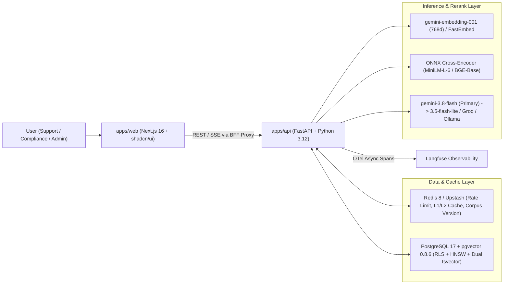
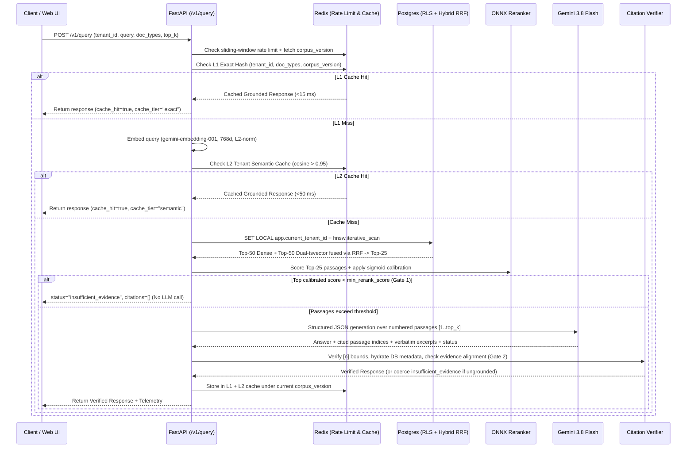

# Product Requirements Document (PRD): CiteOps

**Product Name:** CiteOps — Multi-Tenant Tier-2 Support & Security Compliance Knowledge Engine  
**Document Status:** Approved Engineering PRD (Verified Stack & Free-Tier Edition)  
**Target Role Positioning:** Senior Applied AI / AI Systems Engineer  
**Source Specification:** [Problem.md](./Problem.md)  
**Last Updated:** 2026-11-21  

---

## 1. Executive Summary & Problem Context

**CloudPulse Infrastructure** serves 150+ enterprise B2B customers. Solutions Architects and Tier-2 Support Engineers currently lose **15+ engineering hours per week** manually searching across 300+ pages of fragmented documentation (API specifications, SDK error-code references, SOC 2 / ISO-27001 policies, Enterprise SLA contracts, and release changelogs) to handle two high-stakes workflows:

1. **Enterprise Security & RFP Questionnaires (Pre-Sales & Legal):** Requires exact policy verification (e.g., AES-256 encryption enforcement, Sev-1 RTO failover windows, HIPAA BAA addendum requirements). Unverified claims create immediate legal and contractual liability.
2. **Tier-2 Production Incident Escalations (Post-Sales Engineering):** Requires exact matching of alphanumeric identifiers (e.g., `ERR_SIG_4092`, SDK `v2.4.1`, `Section 4.2`) and version-specific runbook procedures to meet strict SLA response windows.

**CiteOps** solves the four structural failures of naive RAG prototypes—dense retrieval blind spots on exact identifiers, uncited LLM hallucinations, redundant latency/spend on repeat queries, and silent quality regressions—by engineering retrieval, citation grounding, tenant-scoped caching, and CI evaluation as deterministic, testable systems designed to operate on **$0/month free-tier infrastructure**.

---

## 2. Target User Personas & User Stories

### Persona A: Tier-2 Support Engineer
* **Story A1:** As a Tier-2 engineer, I can select a specific customer workspace (`tenant_id`) and filter by document type (`api_docs`, `runbook`) so I only see runbooks applicable to that tenant.
* **Story A2:** As a Tier-2 engineer, I can click inline citation badges (`[1]`, `[2]`) in an answer to open a side-panel Source Inspector displaying the exact document title, version, page number, reranker confidence score, and highlighted excerpt.
* **Story A3:** As a Tier-2 engineer, when querying exact error codes (`ERR_SIG_4092`) or SDK versions (`v2.4.1`), hybrid lexical + semantic retrieval surfaces the exact passage even when phrasing differs.

### Persona B: Solutions Architect / Compliance Lead
* **Story B1:** As a compliance lead, when documentation does not directly answer a security question, CiteOps explicitly returns `status: "insufficient_evidence"` explaining what proof is missing rather than fabricating an answer.
* **Story B2:** As a solutions architect, repeated RFP questions (e.g., SOC 2 Type II controls, RTO/RPO guarantees) resolve from the tenant-scoped semantic cache in `< 50 ms` while preserving full citation metadata.

### Persona C: AI Platform Engineer
* **Story C1:** As an AI platform engineer, I can upload updated PDF/Markdown files via the Knowledge Base UI or `POST /v1/ingest` and see idempotent SHA-256 deduplication (`indexed` vs. `skipped_unchanged`) with `$0` redundant embedding calls.
* **Story C2:** As an AI platform engineer, I can delete or supersede outdated documents and have stale semantic cache entries invalidated immediately for that tenant.
* **Story C3:** As an AI platform engineer, every query trace (retrieval, reranking, caching, LLM latency, token counts) is logged to Langfuse, and GitHub Actions blocks pull requests that regress retrieval recall or faithfulness.

---

## 3. Core Objectives & Measurable Success Criteria (SLOs)

| Engineering Objective | Architectural Mechanism | Target Production Metric |
| :--- | :--- | :--- |
| **Zero Cross-Tenant Data Leakage** | Strict `tenant_id` enforcement via PostgreSQL Row-Level Security (RLS) + query filters + tenant-prefixed Redis keys | `0%` cross-tenant retrieval or cache leakage |
| **Zero-Cost Idempotent Syncs** | SHA-256 `content_hash` deduplication (`UNIQUE(tenant_id, content_hash)`) + document versioning | `$0` re-embedding cost for unchanged files |
| **High-Precision Hybrid Retrieval** | `pgvector >= 0.8` HNSW (`iterative_scan`) + dual-dictionary `tsvector` (`simple` + `english`) fused via RRF + Cross-Encoder Reranker | Context Recall `>= 0.85` on 50-question golden benchmark |
| **Verifiable Grounding & Abstention** | Structured JSON output + deterministic server-side citation hydrator/verifier + dual-gate abstention | Faithfulness `>= 0.90`; `100%` abstention on out-of-scope queries |
| **Low-Latency Repeat Queries** | Tenant- & corpus-version-scoped Redis L1 exact + L2 semantic cache (cosine `> 0.95`) | Cache-hit p95 latency `< 50 ms`; `~40%` LLM call reduction |
| **Automated CI/CD Quality Gate** | Deterministic unit/retrieval suite + rate-limit-safe `DeepEval` smoke gate on PRs; full 50-question suite nightly/release | Automated build failure if Faithfulness `< 0.90` or Recall `< 0.85` |
| **Zero-Cost Hosting & Inference** | Free-tier LLM/Embeddings + lightweight ONNX reranker profile + serverless free cloud DB/Cache | `$0/month` operating cost for demo & CI |

---

## 4. Verified Technology Stack & Architectural Upgrades

An audit of [Problem.md](./Problem.md) identified several version, compatibility, memory-footprint, and cost gaps that must be resolved to build CiteOps cleanly on free-tier APIs and cloud hosting.

### 4.1 Stack Verification & Upgrade Matrix

| Layer | Original Spec (`Problem.md`) | Verified Issue / Risk | PRD Production Decision |
| :--- | :--- | :--- | :--- |
| **Primary LLM** | OpenAI / LiteLLM (`gpt-4o-mini`) | Paid API only; no free tier | **Google `gemini-3.8-flash`** (Google AI Studio Free Tier) via `google-genai` / LiteLLM adapter, with **`gemini-3.5-flash-lite`** fallback + **Groq / Ollama** adapter support |
| **Embeddings** | Implicit OpenAI `vector(1536)` | Paid embeddings assumed; hardcoded 1536 dims | **`gemini-embedding-001`** (`output_dimensionality=768`, L2-normalized, free tier) **or** local FastEmbed `BAAI/bge-small-en-v1.5` (`384d`); schema defaults to `vector(768)` |
| **Vector DB & Search** | `pgvector:pg17` + `tsvector` BM25 | Unpinned `pgvector < 0.8` drops recall under `tenant_id` filters; `english` stemming mangles `ERR_SIG_4092`; `ts_rank_cd` is TF/proximity, not Okapi BM25 | **`pgvector/pgvector:0.8.6-pg17`** (Neon Free in cloud) with `SET LOCAL hnsw.iterative_scan = relaxed_order`, **Postgres RLS**, and dual `simple` + `english` `tsvector` |
| **Cross-Encoder Reranker** | `BAAI/bge-reranker-base` (FastEmbed) or Cohere | `bge-reranker-base` takes `~1.1–1.5 GB` RAM (OOMs 512 MB free cloud tiers); Cohere Trial is 1k calls/mo non-commercial | Configurable **Reranker Profile**: `Xenova/ms-marco-MiniLM-L-6-v2` (`~80 MB`, 512 MB RAM safe) default for free cloud; `BAAI/bge-reranker-base` for local Docker / 16 GB HF Spaces; sigmoid logit normalization |
| **Semantic Cache** | Redis 7 | Vanilla `redis:7` & Upstash Free lack RediSearch vector indexing; missing cache invalidation on ingest | **`redis:8-alpine`** (local) / **Upstash Redis Free** (cloud); portable L1 exact hash + L2 tenant-bounded NumPy cosine cache keyed by `(tenant_id, doc_types, corpus_version)` |
| **PDF / Doc Parser** | Unspecified | Tables, multi-page citations (`page_number`), and code blocks break under naive `pypdf` | **`pymupdf4llm`** (`page_chunks=True` Markdown + table preservation; optional `pdfplumber` fallback if MIT licensing required) |
| **Frontend** | Next.js 15 + shadcn/ui | Next.js 16 (`v16.4.x`) is now active LTS; Tailwind v4 + React 19 patterns | **Next.js 16 (App Router) + React 19 + TypeScript + Tailwind CSS v4 + shadcn/ui + TanStack Query v5** |
| **Eval Gate** | DeepEval 50-Q on every PR | Default DeepEval requires OpenAI; 50×3 judge calls/PR hits free-tier RPM/RPD limits | **`DeepEval` `GeminiModel("gemini-3.5-flash-lite")`**; **Tier-1 PR Gate** (deterministic retrieval + 12-Q DeepEval smoke) & **Tier-2 Nightly/Release Gate** (full 50-Q paced suite) |
| **Cloud Hosting** | Railway / Fly.io + Vercel | Fly.io has no permanent free tier; Railway Free caps at `$1/mo` & 512 MB RAM | **Vercel Hobby (Web)** + **Render Free (API 512 MB) or Hugging Face Spaces Docker Free (API 16 GB)** + **Neon Free (Postgres)** + **Upstash Free (Redis)** + **Langfuse Cloud Hobby** |

### 4.2 Best Free-Tier LLM Analysis & Recommendation

| Provider & Model | Free Tier Cost | Context & Structured Output | Observed Free Quotas | Strengths & Caveats | CiteOps Role |
| :--- | :--- | :--- | :--- | :--- | :--- |
| **Google Gemini 3.8 Flash (`gemini-3.8-flash`)** | **$0** (Input, Output, Context Caching) | **1,048,576** input / **65,536** output; native Pydantic JSON Schema; `thinking_level` (`low`/`medium`/`high`) | Dynamic per-project (`~5–15 RPM` typical; higher on Flash-Lite) | Best reasoning & structured citation accuracy on free tier. Latest recommended Flash line (do not start new projects on 2.5 models, which Google limits to prior active users). *Privacy note: Free tier inputs/outputs may be used for product improvement.* | **Primary Generation LLM** (`thinking_level="low"` for fast grounded synthesis) |
| **Google Gemini 3.5 Flash-Lite (`gemini-3.5-flash-lite`)** | **$0** | **1,048,576** input / **65,536** output; native Structured Outputs | Higher RPM/RPD allowance (`~15–30 RPM`, `~500–1,500 RPD`) | Faster, higher quota ceiling for batch evaluation and burst traffic | **Primary Eval Judge (`DeepEval`) & Burst Fallback** |
| **Groq (`llama-3.3-70b-versatile` / `openai/gpt-oss-120b`)** | **$0** | 128K context; OpenAI-compatible JSON mode | `30 RPM`, `1,000 RPD`, **`8,000–12,000 TPM`** | Blistering LPU speed, **but tight 8k–12k TPM caps** exhaust quickly when sending 5 retrieved passages (~3–5k tokens/req) | **Secondary API Fallback** on Gemini `429` |
| **OpenRouter (`openrouter/free` / `:free` models)** | **$0** | Varies by routed model | `20 RPM`, **`50 RPD`** (`1,000 RPD` if `$10` credits loaded) | Too restrictive (`50 RPD`) for primary or CI workloads; rotating models | **Tertiary Emergency Fallback** |
| **Local Ollama (`qwen3:8b` / `llama3.1:8b`)** | **$0** (local CPU/GPU) | 32K–128K context | Unlimited local | **Zero external data egress**; solves free-tier training/privacy concern for sensitive compliance docs | **Private / Air-Gapped Mode** (`LLM_PROVIDER=ollama`) |

> [!IMPORTANT]
> **Compliance & Privacy Notice on Free-Tier APIs:** Google AI Studio Free Tier terms permit Google to use submitted prompts and outputs to improve its products. For demo/benchmarking with synthetic CloudPulse documents, `gemini-3.8-flash` on the Free Tier is ideal. For real enterprise customer deployments containing confidential SLAs or SOC 2 policies, CiteOps supports switching `GEMINI_API_KEY` to a Paid Tier project (zero training on customer data) or setting `LLM_PROVIDER=ollama` with zero architectural changes.

---

## 5. System Architecture & Data Flows

### 5.1 High-Level Monorepo Architecture



### 5.2 Query Execution & Verification Pipeline (`POST /v1/query`)



---

## 6. Database Schema & Multi-Tenant Isolation Spec

All tenant-owned tables enforce **defense-in-depth**: explicit `WHERE tenant_id = :tenant_id` predicates **and** PostgreSQL Row-Level Security (RLS) bound per transaction via `SET LOCAL app.current_tenant_id`.

### Core Tables & Indexes

1. **`tenants`**
   * `id TEXT PRIMARY KEY` (slug, e.g., `acme-corp`, `globex-io`)
   * `name TEXT NOT NULL`, `created_at TIMESTAMPTZ DEFAULT now()`

2. **`documents`**
   * `id UUID PRIMARY KEY DEFAULT gen_random_uuid()`
   * `tenant_id TEXT NOT NULL REFERENCES tenants(id) ON DELETE CASCADE`
   * `doc_title TEXT NOT NULL`
   * `doc_type TEXT NOT NULL CHECK (doc_type IN ('api_docs', 'security_policy', 'sla_contract', 'runbook'))`
   * `version TEXT NOT NULL`
   * `source_filename TEXT NOT NULL`
   * `content_hash CHAR(64) NOT NULL` (SHA-256 hex digest of raw uploaded bytes)
   * `embedding_model TEXT NOT NULL`, `embedding_dim INT NOT NULL DEFAULT 768`
   * `page_count INT NOT NULL`, `chunk_count INT NOT NULL`
   * `is_active BOOLEAN NOT NULL DEFAULT true`
   * `created_at TIMESTAMPTZ NOT NULL DEFAULT now()`
   * **Constraints:** `UNIQUE (tenant_id, content_hash)` (guarantees zero-cost idempotent re-syncs).

3. **`document_chunks`**
   * `id UUID PRIMARY KEY DEFAULT gen_random_uuid()`
   * `tenant_id TEXT NOT NULL`
   * `document_id UUID NOT NULL REFERENCES documents(id) ON DELETE CASCADE`
   * `doc_type TEXT NOT NULL` (denormalized for single-table filtered index scans)
   * `chunk_index INT NOT NULL`
   * `page_number INT NOT NULL DEFAULT 1`
   * `section_path TEXT` (e.g., `"Section 4.2 > Encryption at Rest"`)
   * `content TEXT NOT NULL` (raw passage text stored for verbatim citation inspection)
   * `contextual_content TEXT NOT NULL` (breadcrumb-prefixed text used for embedding & FTS)
   * `token_count INT NOT NULL`
   * `embedding vector(768) NOT NULL`
   * `search_tsv tsvector GENERATED ALWAYS AS (setweight(to_tsvector('simple', coalesce(section_path, '') || ' ' || content), 'A') || setweight(to_tsvector('english', contextual_content), 'B')) STORED`
   * **Indexes:**
     * `CREATE INDEX idx_chunks_hnsw ON document_chunks USING hnsw (embedding vector_cosine_ops) WITH (m = 16, ef_construction = 64);`
     * `CREATE INDEX idx_chunks_tsv ON document_chunks USING gin (search_tsv);`
     * `CREATE INDEX idx_chunks_tenant_type ON document_chunks (tenant_id, doc_type, document_id);`

4. **Row-Level Security Policy (Required on `documents` & `document_chunks`):**
   ```sql
   ALTER TABLE documents ENABLE ROW LEVEL SECURITY;
   ALTER TABLE document_chunks ENABLE ROW LEVEL SECURITY;

   CREATE POLICY tenant_isolation_documents ON documents
     USING (tenant_id = current_setting('app.current_tenant_id', true));

   CREATE POLICY tenant_isolation_chunks ON document_chunks
     USING (tenant_id = current_setting('app.current_tenant_id', true));
   ```
   *(Application DB role must NOT be a `SUPERUSER` or `BYPASSRLS` role so RLS is strictly enforced.)*

---

## 7. Functional Requirements

### FR-1: Multi-Tenancy & Security Isolation
* Every `/v1/ingest`, `/v1/query`, `/v1/documents`, and `/v1/metrics` request **must** require a validated `tenant_id` (`^[a-z0-9][a-z0-9_-]{1,62}$`).
* Database operations run inside an explicit transaction executing `SET LOCAL app.current_tenant_id = :tenant_id` before any read/write.
* Redis keys are strictly namespaced with `{tenant_id}` (`rl:{tenant_id}:...`, `cache:exact:{tenant_id}:...`, `cache:vec:{tenant_id}:...`).

### FR-2: Idempotent Document Ingestion & Lifecycle
* Supported formats: `.pdf` (max 25 MB, parsed via `pymupdf4llm` with `page_chunks=True` to preserve 1-based `page_number`, headings, and Markdown tables) and `.md` / `.txt` (preserving heading hierarchy, defaulting to `page_number = 1` or explicit page markers).
* **Idempotency:** Compute SHA-256 over raw file bytes. If `(tenant_id, content_hash)` exists and `is_active = true`, immediately return `200 OK` with `status: "skipped_unchanged"` and make zero embedding API calls.
* **Superseding Versions:** Optional `replace_existing` / matching `(tenant_id, doc_title, doc_type)` with a new `content_hash` marks previous active versions `is_active = false` (or replaces chunks atomically) and increments `tenant:version:{tenant_id}` in Redis.
* **Structure-Aware Chunking:** Split along Markdown headers first (`H1–H3`), keep Markdown tables and fenced code blocks intact up to max chunk ceiling (`600` tokens), apply `450`-token target window with `65`-token overlap for long prose, and prepend `[doc_title | version | section_path | Page N]` into `contextual_content`.
* **Document Management:** Support `GET /v1/documents?tenant_id=...` and `DELETE /v1/documents/{document_id}?tenant_id=...` (cascades chunk deletion and increments Redis `corpus_version`).

### FR-3: Hybrid Retrieval & Calibrated Reranking
* **Dense Branch:** Top-50 active chunks via `embedding <=> query_embedding` with `SET LOCAL hnsw.iterative_scan = relaxed_order` and `hnsw.ef_search = 64` (filtered by `tenant_id`, `is_active`, and optional `doc_types`).
* **Lexical Branch:** Top-50 active chunks via `websearch_to_tsquery('simple', query) || websearch_to_tsquery('english', query)` ranked by `ts_rank_cd(search_tsv, query_ts)` so exact error codes (`ERR_SIG_4092`), versions (`v2.4.1`), and section numbers (`4.2`) match verbatim alongside stemmed keywords.
* **Reciprocal Rank Fusion (RRF):** Fuse dense and lexical ranked lists using:
  $$\text{RRF}(d) = \sum_{i \in \{\text{dense}, \text{lexical}\}} \frac{1}{60 + \text{rank}_i(d)}$$
  Keep top `RERANK_CANDIDATE_COUNT` (`25` default for CPU/free-tier speed, configurable up to `50`).
* **Cross-Encoder Reranking & Calibration:** Score `(query, chunk.contextual_content)` pairs via ONNX `TextCrossEncoder`:
  * Default Cloud Profile (`RERANKER_PROFILE=light`): `Xenova/ms-marco-MiniLM-L-6-v2` (~80 MB).
  * High-Accuracy Profile (`RERANKER_PROFILE=base`): `BAAI/bge-reranker-base` (~1.04 GB).
  * Apply sigmoid normalization $s = \frac{1}{1 + e^{-\text{logit}}}$ so `rerank_score` is consistently bounded in `(0, 1)` for thresholding and UI display. Return top `top_k` (default `5`).

### FR-4: Citation-Locked Generation, Verification & Abstention
* **Dual-Gate Abstention:**
  * **Gate 1 (Pre-LLM Retrieval Gate):** If `len(reranked) == 0` or `max(rerank_score) < MIN_RERANK_SCORE` (default `0.35`, tuned during eval calibration), immediately return `status: "insufficient_evidence"`, an explanation of the gap, and `citations: []` **without calling the LLM**.
  * **Gate 2 (LLM Structured Evidence Gate):** Prompt `gemini-3.8-flash` (`temperature=0.0`, `thinking_level="low"`, Pydantic `response_schema`) with numbered passages `[1]..[k]`. System instruction mandates: rely *exclusively* on provided passages; if evidence does not directly answer *all* parts of the query (e.g., partial match where a BAA is an addendum rather than included), either state exact conditional boundaries backed by citations or return `status: "insufficient_evidence"`.
* **Deterministic Server-Side Citation Verifier & Hydrator:**
  * The LLM outputs only `status`, `answer` (with `[1]`, `[2]` markers), `missing_evidence_reason` (optional), and `used_passages: [{passage_index, supporting_quote}]`.
  * Backend code validates every `[n]` marker in `answer` references a valid index in `1..len(reranked)`, verifies `supporting_quote` (or extracts the highest-overlap verbatim excerpt from `chunk.content`), and hydrates `document_id`, `doc_title`, `doc_type`, `version`, `page_number`, and `rerank_score` **strictly from PostgreSQL chunk metadata**—eliminating LLM-hallucinated document IDs or page numbers.
  * If `status == "answered"` has zero valid citations or dangling `[n]` references after verification, automatically downgrade to `status: "insufficient_evidence"` (or strip/fail-safe) and log an alert span in Langfuse.

### FR-5: Tenant-Scoped Semantic Caching & Rate Limiting
* **Corpus Version Keying:** Every tenant maintains an integer `corpus_version` in Redis (`tenant:version:{tenant_id}`, initialized to `1`, incremented atomically on ingest or delete).
* **Two-Tier Cache Lookup:**
  * **L1 Exact Normalized Cache:** `cache:exact:{tenant_id}:{corpus_version}:{doc_types_key}:{sha256(lowercase_collapsed_query)}`. TTL = `24h`.
  * **L2 Semantic Cache:** `cache:vec:{tenant_id}:{corpus_version}:{doc_types_key}` storing up to `500` recent `(query_embedding_f32, response_json)` entries per tenant/filter scope. On lookup, compute vectorized NumPy cosine similarity in Python (`< 1 ms` for 500×768 vectors). Hit when cosine similarity `> 0.95`. Works identically on local Redis 8 and Upstash Redis Free.
* **Abstention Cache Policy:** Do **not** cache transient LLM/rate-limit failures; optionally cache deterministic Gate-1 `insufficient_evidence` misses with short TTL (`1h`) keyed by `corpus_version` so new uploads immediately unlock answers.
* **Sliding-Window Rate Limiter:** Redis ZSET sliding window enforcing per-tenant (e.g., `20 req/min`) and global free-tier protection (`12 req/min` upstream LLM cap on cache misses), returning HTTP `429` with `Retry-After` on overflow.

### FR-6: Frontend Workspace (`apps/web`)
Built with **Next.js 16 (App Router) + React 19 + TypeScript + Tailwind CSS v4 + `shadcn/ui` + TanStack Query v5**:
1. **Perplexity-Style Citation Workspace (`/`):**
   * Top bar: Tenant selector (`acme-corp`, `globex-io`, custom), `doc_types` multi-filter pills (`all`, `api_docs`, `security_policy`, `sla_contract`, `runbook`), and link to Knowledge Base & Metrics.
   * Query composer with sample RFP & Tier-2 incident prompt chips.
   * Grounded Answer card rendering inline clickable `[1]`, `[2]` citation pills—or a clear amber **Insufficient Evidence** state card explaining what documentation is missing.
   * **Telemetry Pill Bar:** Live `latency_ms`, `CACHE HIT (EXACT / SEMANTIC)` vs. `CACHE MISS` badge, `top_rerank_score`, active `model`, and Langfuse `trace_id` link/pill.
   * **Source Inspector Drawer:** Opens automatically or on citation click, displaying `doc_title`, `version`, `doc_type`, `page_number`, `section_path`, `rerank_score`, and highlighted verbatim `excerpt`.
2. **Knowledge Base Manager (`/documents`):**
   * Drag-and-drop PDF/Markdown upload modal with `doc_type` and `version` inputs.
   * Immediate feedback badge showing `indexed` (with `chunk_count`) vs. `skipped_unchanged` (`$0` re-embedding badge).
   * Document inventory table per tenant with version, page count, hash preview, and Delete action.
3. **Observability & Metrics View (`/metrics`):**
   * Live summary cards aggregated from backend telemetry/Postgres: total queries, cache hit rate (L1 vs. L2), median/p95 latency (cache hit vs. miss), abstention rate, and active model/reranker profile.

### FR-7: Observability & Upstream Resilience
* **Langfuse v3+ (OpenTelemetry):** Root `@observe()` trace per `/v1/query` and `/v1/ingest` tagged with `tenant_id`, `cache_hit`, `status`, `model`, with child spans for `cache_lookup`, `embed_query`, `hybrid_retrieval`, `rerank`, `llm_generate`, and `citation_verify`.
* **Quota Resilience:** Exponential backoff with jitter (`tenacity`) on upstream `429`/`503` errors, automatic failover chain (`gemini-3.8-flash` → `gemini-3.5-flash-lite` → optional Groq fallback), and graceful timeout handling.

---

## 8. API Contracts

### 8.1 `POST /v1/ingest` (`multipart/form-data`)
* **Request Fields:** `file` (`.pdf` | `.md` | `.txt`), `tenant_id` (str), `doc_type` (`api_docs` | `security_policy` | `sla_contract` | `runbook`), `version` (str, e.g. `"v2.4.1"`), `doc_title` (optional str, defaults to filename).
* **Response (`200 OK`):**
  ```json
  {
    "status": "indexed",
    "document_id": "d8f2c1a0-4b3e-4a91-9f22-8e1a9103c412",
    "tenant_id": "acme-corp",
    "doc_title": "Webhook Integration & Error Reference",
    "doc_type": "api_docs",
    "version": "v2.4.1",
    "content_hash": "9f86d081884c7d659a2feaa0c55ad015a3bf4f1b2b0b822cd15d6c15b0f00a08",
    "page_count": 18,
    "chunk_count": 42,
    "corpus_version": 4,
    "latency_ms": 620
  }
  ```
  *(When `(tenant_id, content_hash)` already exists and is active, returns `status: "skipped_unchanged"` with `chunk_count: 0` embedded and `$0` embedding API cost.)*

### 8.2 `POST /v1/query` (`application/json`)
* **Request:**
  ```json
  {
    "tenant_id": "acme-corp",
    "query": "Why does webhook signature verification fail with ERR_SIG_4092 on SDK v2.4.1, and what is the rollback procedure?",
    "doc_types": ["api_docs", "runbook"],
    "top_k": 5
  }
  ```
* **Response — Answered (`200 OK`):**
  ```json
  {
    "status": "answered",
    "answer": "Webhook signature verification fails with ERR_SIG_4092 on SDK v2.4.1 when middleware parses and re-serializes the JSON body before HMAC-SHA256 validation [1]. Pass the unparsed raw request byte buffer to verifySignature(), or roll back to SDK v2.4.0 using npm install @cloudpulse/sdk@2.4.0 [1][2].",
    "missing_evidence_reason": null,
    "citations": [
      {
        "citation_index": 1,
        "document_id": "d8f2c1a0-4b3e-4a91-9f22-8e1a9103c412",
        "doc_title": "Webhook Integration & Error Reference",
        "doc_type": "api_docs",
        "version": "v2.4.1",
        "page_number": 14,
        "section_path": "4.3 Webhook Error Codes > ERR_SIG_4092",
        "rerank_score": 0.94,
        "excerpt": "ERR_SIG_4092: Payload digest mismatch triggered when middleware mutates whitespace prior to HMAC-SHA256 verification. Pass the unparsed raw byte buffer to verifySignature()."
      }
    ],
    "telemetry": {
      "cache_hit": false,
      "cache_tier": "miss",
      "latency_ms": 980,
      "retrieval_ms": 42,
      "rerank_ms": 135,
      "llm_ms": 760,
      "model": "gemini-3.8-flash",
      "reranker_model": "Xenova/ms-marco-MiniLM-L-6-v2",
      "top_rerank_score": 0.94,
      "trace_id": "lf_91a8c2f4e109"
    }
  }
  ```
* **Response — Safe Abstention (`200 OK`):**
  ```json
  {
    "status": "insufficient_evidence",
    "answer": "Insufficient evidence in the tenant knowledge base to answer this question reliably.",
    "missing_evidence_reason": "No active documents for tenant 'acme-corp' specify FedRAMP High authorization status or timeline.",
    "citations": [],
    "telemetry": {
      "cache_hit": false,
      "cache_tier": "miss",
      "latency_ms": 165,
      "retrieval_ms": 38,
      "rerank_ms": 122,
      "llm_ms": 0,
      "model": "none (gate_1_abstain)",
      "reranker_model": "Xenova/ms-marco-MiniLM-L-6-v2",
      "top_rerank_score": 0.14,
      "trace_id": "lf_77c3b102d8a1"
    }
  }
  ```

### 8.3 Supporting Endpoints
* `GET /v1/documents?tenant_id={tenant_id}&doc_type={optional}` — Lists active documents and metadata.
* `DELETE /v1/documents/{document_id}?tenant_id={tenant_id}` — Deletes document + chunks (via RLS) and increments `corpus_version`.
* `GET /v1/metrics/summary?tenant_id={tenant_id}` — Aggregated query count, cache-hit %, abstention %, and latency percentiles.
* `GET /v1/health` — Checks PostgreSQL + `pgvector` extension, Redis connectivity, and reranker readiness.

---

## 9. Evaluation Framework & Automated CI/CD Quality Gate

### 9.1 Golden Benchmark Dataset (`evals/datasets/golden_50.jsonl`)
A curated **50-question benchmark** across realistic seeded CloudPulse enterprise documents (`API Error Reference v2.4`, `Enterprise SLA Contract`, `SOC 2 & ISO-27001 Security Policy`, `Production Rollback Runbooks`) covering 4 categories:
1. **Exact Code & Version Lookups (15 Qs):** e.g., `ERR_SIG_4092`, `SDK v2.4.1`, `HTTP 429 X-RateLimit-Reset`.
2. **Compliance & SLA Policy Nuances (15 Qs):** e.g., AES-256 at rest, Sev-1 RTO (`15 minutes`), HIPAA BAA addendum requirement (trap if answered "included by default").
3. **Multi-Passage / Tabular Synthesis (10 Qs):** e.g., comparing tier SLAs and escalation procedures across pages.
4. **Out-of-Scope Abstention Traps (10 Qs):** Questions whose answers do not exist in the tenant's corpus (must achieve `100%` `insufficient_evidence`, **and** cross-tenant isolation probes where a fact exists only in `globex-io` while querying `acme-corp`).

### 9.2 Two-Tier Free-Tier-Safe CI Strategy
Running 50 DeepEval test cases × 3 LLM metrics per commit triggers `~300–600` LLM judge calls, exceeding Google AI Studio free-tier RPM/RPD limits on active PRs. CiteOps solves this with a two-tier gate:

1. **Tier 1 — PR Quality Gate (`.github/workflows/ci.yml`, runs on every PR):**
   * **Static & Type Checks:** `ruff check`, `mypy`, `eslint`, `tsc --noEmit`.
   * **Unit & Integration Tests (`pytest`):** Tenant RLS isolation tests, SHA-256 deduplication tests, RRF fusion math, citation verifier tests, Gate-1 abstention tests, semantic cache invalidation tests.
   * **Deterministic Retrieval Benchmark (All 50 Qs, 0 LLM calls):** Validates `Context Recall@5 >= 0.85` against expected `(doc_title, page_number / chunk_tag)` ground truth.
   * **DeepEval Stratified Smoke Suite (12 Qs, `~36` judge calls):** Uses `DeepEval` `GeminiModel(model="gemini-3.5-flash-lite")` with `max_concurrent=2` + retry backoff; fails PR if `Faithfulness < 0.90`, `Answer Relevancy < 0.85`, or `Abstention Accuracy < 1.0`.

2. **Tier 2 — Full 50-Question Benchmark (`.github/workflows/eval_full.yml`, nightly cron & manual `workflow_dispatch`):**
   * Executes `evals/run_benchmark.py` across all 50 golden questions using paced concurrency (`--concurrency 2 --delay-ms 1500`), publishing Markdown scorecards (Faithfulness, Answer Relevancy, Context Recall, Abstention Accuracy, Cache-Hit p95, Cache-Miss p95) as workflow summaries/artifacts.

---

## 10. Non-Functional Requirements

* **Latency Targets:**
  * Cache Hit (L1 Exact / L2 Semantic): `< 50 ms` p95 (excluding network RTT).
  * Cache Miss (Retrieval + ONNX Rerank + `gemini-3.8-flash` `thinking=low`): `< 2,500 ms` p95.
* **Memory Budget:**
  * With `RERANKER_PROFILE=light` (`ms-marco-MiniLM-L-6-v2`) + API embeddings (`gemini-embedding-001`), total `apps/api` steady-state RSS memory must stay **`<= 400 MB`** so it runs stably inside **512 MB RAM** free cloud containers (Render Free).
* **Reliability & Idempotency:**
  * Failed embeddings or DB rollbacks during `/v1/ingest` must not leave partial chunks or corrupt `content_hash` records (single atomic transaction after embedding generation).
* **Security:**
  * Backend API keys (`GEMINI_API_KEY`, `LANGFUSE_SECRET_KEY`, `DATABASE_URL`) are strictly server-side; Next.js proxies or validates requests without leaking secrets to client bundles.

---

## 11. Monorepo Directory Structure

```text
citeops/
├── apps/
│   ├── api/                        # Python 3.12 + FastAPI AI Backend (uv / pyproject.toml)
│   │   ├── app/
│   │   │   ├── api/v1/             # ingest.py, query.py, documents.py, metrics.py, health.py
│   │   │   ├── core/               # config.py, logging.py, telemetry.py (Langfuse/OTel), rate_limit.py
│   │   │   ├── db/                 # pool.py, migrations/001_init.sql (pgvector 0.8 + RLS)
│   │   │   ├── schemas/            # Strict Pydantic v2 contracts & LLM response schemas
│   │   │   └── services/           # parser.py, chunker.py, embeddings.py, retriever.py,
│   │   │                           # reranker.py, cache.py, generator.py, verifier.py
│   │   ├── tests/                  # Unit & Postgres/Redis integration tests
│   │   ├── Dockerfile
│   │   └── pyproject.toml
│   │
│   └── web/                        # Next.js 16 (App Router) + React 19 + TypeScript
│       ├── src/
│       │   ├── app/                # page.tsx (Workspace), documents/page.tsx, metrics/page.tsx
│       │   ├── components/         # CitationBadge, SourceDrawer, QueryBox, UploadModal, TelemetryBar
│       │   └── lib/                # api.ts, types.ts
│       ├── Dockerfile
│       └── package.json
│
├── evals/                          # Automated RAG Evaluation Suite
│   ├── datasets/golden_50.jsonl    # 50-Q RFP, Tier-2 Support, Multi-hop & Abstention benchmark
│   ├── test_rag_quality.py         # DeepEval + pytest (PR smoke & full suite)
│   └── run_benchmark.py            # CLI scorecard generator (accuracy + p50/p95 latency)
│
├── scripts/
│   └── seed_demo.py                # Seeds acme-corp & globex-io docs (API errors, SLA, SOC2, Runbooks)
│
├── .github/
│   └── workflows/
│       ├── ci.yml                  # Lint, unit/RLS tests, deterministic recall@5, 12-Q DeepEval smoke
│       └── eval_full.yml           # Nightly / manual 50-Q paced DeepEval scorecard
│
├── docker-compose.yml              # api, web, postgres (pgvector:0.8.6-pg17), redis (redis:8-alpine)
├── .env.example
├── Problem.md
├── PRD.md
└── README.md
```

---

## 12. Four-Day Execution Roadmap & Acceptance Gates

| Day | Scope & Deliverables | Verification / Exit Criteria |
| :--- | :--- | :--- |
| **Day 1** | Monorepo scaffold (`apps/api`, `apps/web`), `docker-compose.yml` (`pgvector:0.8.6-pg17`, `redis:8-alpine`), SQL migration with RLS + HNSW + dual `tsvector`, `pymupdf4llm` parser + structure chunker, `POST /v1/ingest`, `POST /v1/query` (RRF + `gemini-3.8-flash` + citation verifier), `scripts/seed_demo.py`. | Seeding 2 tenants succeeds; re-ingesting same file returns `skipped_unchanged`; cross-tenant query returns `0` chunks; `ERR_SIG_4092` query returns exact verified page citation. |
| **Day 2** | ONNX Cross-Encoder reranker (`ms-marco-MiniLM-L-6-v2` / `bge-reranker-base` profile + sigmoid calibration), Gate-1 abstention short-circuit, L1+L2 Redis semantic cache with `corpus_version` invalidation, sliding-window rate limiter, Langfuse OTel tracing, `DELETE /v1/documents/{id}`. | Cache hit returns `< 50 ms`; uploading/deleting a doc bumps `corpus_version` and invalidates prior cache; out-of-scope queries return `insufficient_evidence` at Gate 1 (`llm_ms = 0`); traces appear in Langfuse. |
| **Day 3** | Next.js 16 + shadcn/ui Workspace (tenant switcher, `doc_types` filters, clickable inline `[n]` badges, Source Inspector Drawer, Telemetry Pill Bar, Document Manager, Metrics view), 50-Q `golden_50.jsonl`, `DeepEval` (`gemini-3.5-flash-lite` judge), `.github/workflows/ci.yml` & `eval_full.yml`. | E2E UI flow works locally; PR CI workflow passes lint, unit/RLS tests, 50-Q retrieval Recall `>= 0.85`, and 12-Q DeepEval Faithfulness `>= 0.90`. |
| **Day 4** | `$0/mo` cloud deployment (Vercel Web + Render Free / HF Spaces API + Neon Postgres + Upstash Redis + Langfuse Cloud), execute `evals/run_benchmark.py` against live deployment, document architecture diagrams, benchmarks & trade-offs in `README.md`. | Live public URLs verified; 50-Q benchmark scorecard published (`Faithfulness >= 0.90`, `Context Recall >= 0.85`, `Abstention = 100%`, Cache-Hit p95 `< 50 ms`). |

---

## 13. Key Technical Risks & Mitigations

| Risk | Impact | Mitigation |
| :--- | :--- | :--- |
| **Free-tier Gemini `429` rate limits during CI or bursts** | Failed PR builds or dropped queries | Two-tier CI (12-Q PR smoke + nightly 50-Q), `tenacity` backoff, `gemini-3.8-flash` → `gemini-3.5-flash-lite` / Groq failover, L1/L2 semantic cache absorption. |
| **512 MB RAM OOM on free cloud API hosts** | Container crash on startup | `RERANKER_PROFILE=light` (`Xenova/ms-marco-MiniLM-L-6-v2`, ~80 MB) + API embeddings (`gemini-embedding-001`) by default; deploy on HF Spaces (16 GB free RAM) if `bge-reranker-base` is showcased live. |
| **Render Free cold starts (~50s after 15 min idle)** | Slow first demo request | Add health warmup or deploy API on HF Spaces Docker / cron ping during active demo windows; clearly separate DB/cache p95 from cold-start latency in telemetry. |
| **AGPL-3.0 licensing of PyMuPDF (`pymupdf4llm`)** | License restriction if productized closed-source | Isolate parser behind a `DocumentParser` interface; `pdfplumber` (MIT) can swap in seamlessly for PDF extraction. |
| **Free-tier LLM prompt logging privacy** | Compliance risk if used with real customer secrets | Document clearly in UI & README; support zero-code switch to Paid Gemini Tier (no training) or local `Ollama` (`LLM_PROVIDER=ollama`). |
